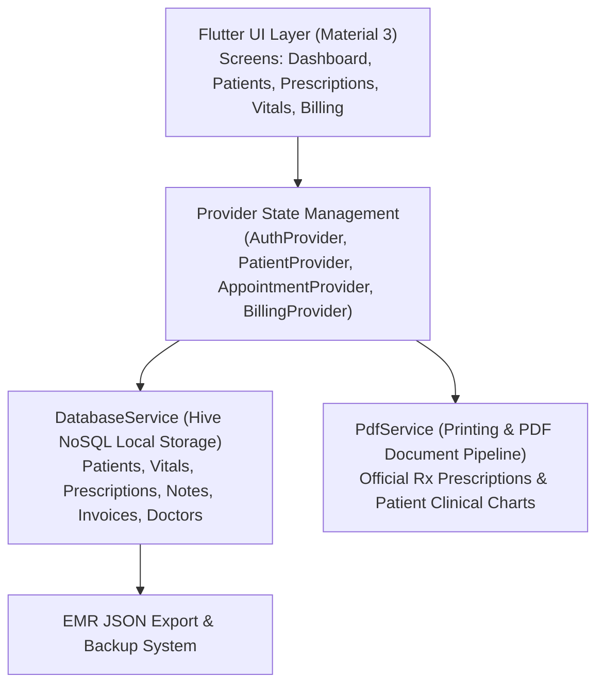

# 🩺 Dr.Clinic — Professional Medical Practice Management & EMR App

[](https://flutter.dev)
[](https://dart.dev)
[](https://pub.dev/packages/provider)
[](https://pub.dev/packages/hive)
[](https://pub.dev/packages/printing)
[-success?style=for-the-badge)](test/)
[](lib/)

> **A production-ready cross-platform medical practice management and Electronic Medical Records (EMR) system for healthcare professionals.** Features offline-first persistent storage (Hive), appointment scheduling, biometric vitals monitoring, clinical SOAP charting, multi-physician authentication, official PDF medical prescription generation, and automated data backup.

---

## 📱 Key Features & Clinical Capabilities

### 1. 🩺 Multi-Physician Authentication & Practice Profiles
- Secure physician sign-in and new doctor registration.
- Custom doctor metadata: Specialty, Medical License Number, Clinic Phone, Professional Email, and Office Hours.
- Dynamic physician profile editing directly from the Settings screen.
- Pre-loaded instant demo access: `doctor@clinic.com` / `password`.

### 2. 👥 Comprehensive Patient Management & EMR
- Real-time patient search and demographic filtering.
- Complete clinical profile: Blood Type, Known Drug Allergies, Emergency Contacts, DOB, Insurance Carrier, and Policy Number.
- Patient history timeline aggregating clinical consultation notes, appointments, billing invoices, and active prescriptions.

### 3. 💓 Patient Vitals & Biometrics Monitoring
- Complete vitals tracker:
  - **Blood Pressure (Systolic / Diastolic mmHg)**
  - **Heart Rate (BPM)**
  - **Body Temperature (°C / °F)**
  - **Respiratory Rate (breaths/min)**
  - **Weight (kg) & Height (cm)**
  - **Auto-calculated Body Mass Index (BMI)**
- Interactive "Record Vitals" modal with immediate metric card rendering.

### 4. ℞ Official Medical Prescription PDF Generation & Printing
- Compliant prescription builder: Medication name, dosage, frequency (BID, TID, QD, PRN), quantity, refills, and special clinical instructions.
- Powered by `pdf` and `printing` packages:
  - **Instant Rx PDF Preview & Direct AirPrint / Network Printing**.
  - Includes Official Clinic & Physician Header, License number, Rx symbol, medication table, validity notice, and Physician Signature & Stamp area.
  - One-tap "Save & Print Rx" workflow for doctors during patient consultations.

### 5. 📄 Full Patient Medical Chart PDF Export
- Generates a multi-page comprehensive clinical report with a single tap:
  - Complete patient demographics & insurance information.
  - Vitals history table.
  - Active and historical medications.
  - Clinical consultation notes with SOAP breakdown (Subjective, Objective, Assessment, Plan) and ICD-10 diagnosis codes.

### 6. 📅 Interactive Appointment Scheduling
- Calendar view powered by `table_calendar` with day and month navigation.
- Color-coded appointment statuses: *Scheduled*, *In-Progress*, *Completed*, *Cancelled*.
- Conflict detection and direct link to patient records.

### 7. 💳 Billing, Invoicing & Analytics
- Medical billing supporting CPT / service codes, co-pays, amounts, and payments.
- Visual practice analytics powered by `fl_chart`:
  - Patient intake metrics.
  - Monthly practice revenue and pending balances.
  - Real-time KPI summary on dashboard.

### 8. 💾 Offline-First Architecture & EMR Backup
- Built with **Hive NoSQL** for sub-millisecond local queries and zero reliance on cloud connectivity in clinical environments.
- **EMR Backup & Restore**: One-tap export of the entire clinical database as formatted JSON.
- **Clinical Demo Seeder**: Easily seed realistic sample patients, vitals, prescriptions, and appointments for demonstration.

---

## 🏗️ Architecture & Component Flow



---

## 🧪 Testing & Verification

The test suite thoroughly validates widget rendering and core clinical models:

```bash
flutter analyze
# Result: No issues found! (ran in 8.2s)

flutter test
# 00:00 +0: StatCard Widget Tests StatCard displays title, value and icon properly
# 00:00 +1: Patient Model Tests Patient serialization and deserialization works correctly
# 00:00 +2: Vital Model Tests Vital calculates BMI and formats blood pressure correctly
# 00:00 +3: Prescription Model Tests Prescription serialization and status validation
# 00:00 +4: Doctor Model Tests Doctor model formats fullName and initials properly
# 00:00 +5: All tests passed!
```

---

## 🚀 Getting Started

### Prerequisites
- [Flutter SDK](https://flutter.dev/docs/get-started/install) (`>= 3.2.0`)
- Android Studio / Xcode / VS Code

### Installation & Run

```bash
# 1. Clone the repository
git clone https://github.com/<your-username>/dr-clinic.git
cd dr-clinic

# 2. Install dependencies
flutter pub get

# 3. Run on connected device, emulator, or Chrome
flutter run
```

### Demo Credentials
- **Email**: `doctor@clinic.com`
- **Password**: `password`
*(Or register a new doctor account directly from the login screen)*

---

## 📜 License

Distributed under the **MIT License**. Free for personal and commercial healthcare practice use.
